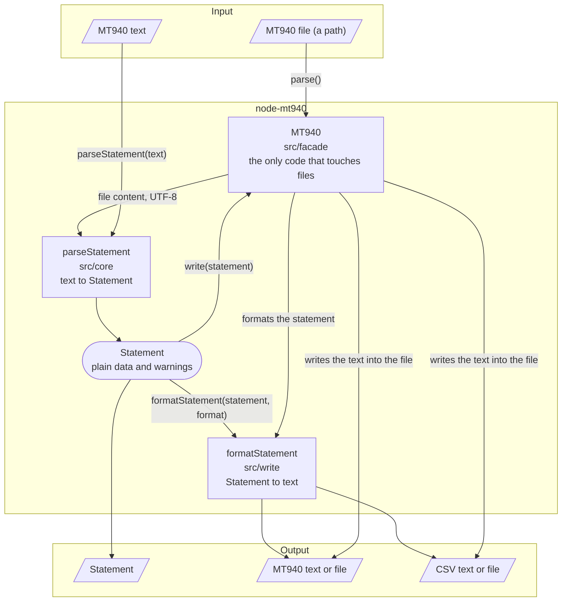
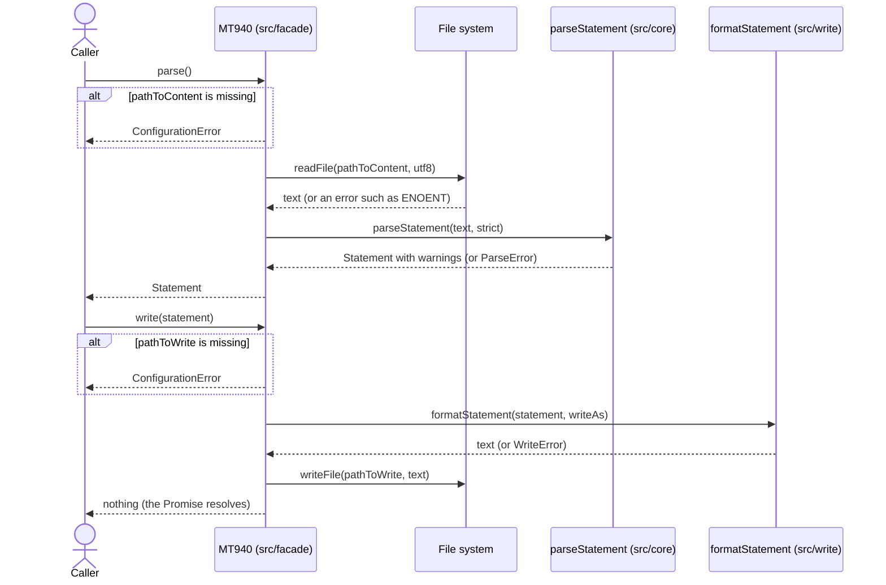
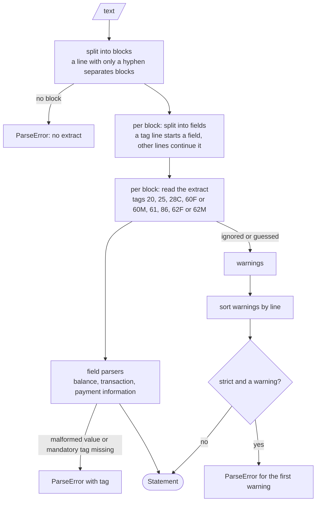

# Architecture

This page shows what goes into the library, what comes out and which component does what in between. The diagrams are
[Mermaid](https://mermaid.js.org) and render on GitHub.

## The process: input, components, output

Read it from the top: MT940 text comes in, either as a file that `MT940` reads or as a string you pass to
`parseStatement`. The parser turns it into a `Statement`. From there you either use the data, or `formatStatement`
turns it into MT940 or CSV text again, which `MT940` can write into a file.

## Who does what

| Component | Directory | Input | Output | Responsibility |
|---|---|---|---|---|
| `parseStatement` | `src/core` | MT940 text, option `strict` | `Statement`, or `ParseError` | Reads the format. Knows the tags, the sub fields of `:86:`, the date rules. Reports what it ignores or guesses. |
| `Statement` | `src/core/statement.ts` | none | none | The result: plain data types, no behaviour. |
| `formatStatement` | `src/write` | `Statement`, format | MT940 or CSV text, or `WriteError` | Writes the formats. Contains `formatMt940` and `formatCsv`, and the amount formatting. |
| `MT940` | `src/facade` | options, a path or a `Statement` | `Promise<Statement>` or `Promise<void>` | Reads and writes files, checks its options. Calls the two functions, contains no format logic. |
| `gvcText` | `src/gvc` | a business transaction code | text or `undefined` | A lookup that is independent of the rest. Neither the parser nor the writer uses it. |

The parser and the writer are pure functions: same input, same output, no file access and no state. Only `MT940`
performs input and output. That keeps the format logic testable without files, and the class small.

## Reading and writing a file step by step

`write()` formats before it writes. A statement that can not be formatted never reaches the file system, so an existing
file stays as it is.

## Inside `parseStatement`

## Why it is built this way

- **One parser, plain data.** There is one `Statement` that the writer and the class work on. Why the earlier plan of a
  second model was dropped is in [ADR 1](../adr/0001-core-is-the-single-basis.md).
- **Nothing is dropped silently.** Everything the parser ignores or guesses ends up in `warnings`. See
  [The data model](data-model.md).
- **The seam for files is the class.** Parser and writer take and return text, so they need no fake file system in
  tests. `MT940` is tested against a real temporary directory.
